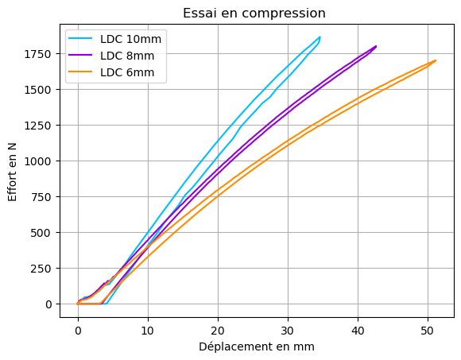

# Carbon-fibre tibial prosthesis: load-line analysis

Data analysis for a school research project (TIPE, French *classes préparatoires*)
on sports tibial prostheses: how does the point where the load is applied on the
carbon blade change its stiffness and its energy return?

## Question

Compression tests were run on a carbon-fibre prosthetic blade with the load applied
at three distances from the blade edge (the "load line"), corresponding to three
blade angles. The goal is to quantify, for each setting, the force/displacement
response, the stiffness, and the share of the stored energy the blade gives back.

## Method

1. **Test bench data**: force and displacement recorded on a compression machine,
   one loading/unloading cycle per setting (`data/*/raw.txt`), plus a version with the
   zero offset corrected (`data/*/corrected.txt`).
2. **Offset correction**: quadratic least-squares fit `F = a x² + b x + c` on the last
   20 raw points, solved with `(AᵀA)⁻¹AᵀY` (see `figures/least_squares_method.png`).
3. **Energy balance**: numerical integration (trapezoidal rule) of the force-displacement
   curve. The loading branch gives the stored energy, the unloading branch the returned
   energy; the area between them is the hysteresis loss.
4. **Stiffness**: mean of the force / displacement ratio from the start of the test up to
   the peak force.

## Results

| Angle | Load line | Peak force | Max displacement | Stiffness | Stored | Returned | Lost | Return |
|------:|----------:|-----------:|-----------------:|----------:|-------:|---------:|-----:|-------:|
| 20° | 10 mm | 1864 N | 34.6 mm | 49.5 kN/m | 32.3 J | 29.3 J | 3.03 J | 90.6 % |
| 17° | 8 mm | 1798 N | 42.6 mm | 53.1 kN/m | 40.6 J | 38.8 J | 1.75 J | 95.7 % |
| 14° | 6 mm | 1701 N | 51.2 mm | 38.5 kN/m | 47.9 J | 45.7 J | 2.28 J | 95.2 % |

A load line closer to the blade edge lets the blade deflect more and store more energy,
and the energy return stays above 90 % in all three cases. The stiffness does not vary
monotonically with the angle, which the method above (a mean of ratios over a non-linear
curve) cannot explain on its own. These are measurements on a single blade and one cycle
per setting, so they illustrate a trend rather than a statistically established result.



## Run it

```bash
pip install -r requirements.txt
python src/analyse_tipe1.py     # 20° / 10 mm
python src/analyse_tipe2.py     # 17° / 8 mm
python src/analyse_tipe3.py     # 14° / 6 mm
```

Each script prints the regression coefficients, energies and stiffness, and saves its
load-line plot in `results/`.

## Repository layout

```
src/        one analysis script per test (Python)
data/       test bench measurements (raw and corrected)
figures/    figures from the project
results/    plots generated by the scripts
```

## Contributions

The research project was done as a team of three with Hopper (the prosthesis company), and
the physical modelling was worked out together. I wrote the analysis code
(data processing, least-squares fit, energy and stiffness computation, plots).
